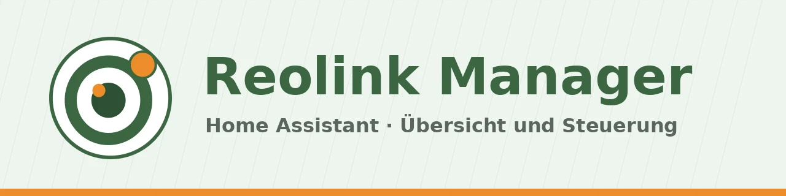

| [🇩🇪<br>**Deutsch**](README.md) | [🇬🇧<br>**English**](README.en.md) | 🇳🇱<br>**Nederlands** |
|:-:|:-:|:-:|



# Reolink Manager

📖 Blogbericht: volgt op [meinesmartewelt.de](https://meinesmartewelt.de) (Duits)

Reolink Manager is een aanvulling voor Home Assistant. Het legt zich over de **officiële Reolink-integratie** en toont camera's, de Home Hub en gongs in één kaart met categorieën: Camera's, Batterij, Detecties, Updates, Opslag, Bediening en Hub.

De manager leest alleen de apparaten, entiteiten en statussen die de Reolink-integratie al levert. Hij praat **zelf niet met de camera's**. Daardoor worden accu-camera's (bijv. Argus) niet extra gewekt.

> **Belangrijk, versie 0.0.1:** Alles in deze versie is nieuw en **ongetest**. De functies zijn daarom standaard **verborgen** en moeten bewust worden ingeschakeld (zie [Experimentele functies](#experimentele-functies)). Er is niets met echte camera's getest. Details in [EXPERIMENTELL.md](EXPERIMENTELL.md) (Duits).

## Functies

| Categorie (tab) | Inhoud | Functie |
|---|---|---|
| Camera's | Status (online, offline, privémodus), slaapstatus, batterij, wifi-signaal | `overview` |
| Batterij | Niveau, toestand, temperatuur, waarschuwingsniveaus laag en kritiek | `overview` |
| Detecties | Beweging, persoon, voertuig, huisdier, dier, gezicht, pakket, bezoeker, babygehuil, fiets, met „laatst gewijzigd” | `overview` |
| Updates | Firmware-updates van de apparaten met geïnstalleerde en nieuwe versie | `overview` |
| Opslag | Gebruik van de SD-kaart of hub-opslag, voor zover de Reolink-integratie dit levert | `overview` |
| Bediening | Privémodus, opname, push, scène van de hub, sirene, licht (schrijft) | `controls` |
| Hub | Home Hub met aantal verbonden apparaten en scène | `overview` |
| Tandwiel | Versie, status van de Reolink-integratie, selectie, opties, onderhoud, gebeurtenissenlogboek, experimenteel | altijd |

Daarnaast (allemaal experimenteel): PTZ-bediening (`ptz`), verversen/wekken (`refresh`), overzichtssensoren (`sensors`), gebeurtenissen op de Home Assistant-bus (`events`).

De apparaatselectie in de opties bepaalt welke camera's, hubs en gongs helemaal verschijnen. Elke categorie heeft in de kaart een eigen schakelaar.

## Nieuw in 0.0.1

Eerste release. Alle functies zijn nieuw en experimenteel.

## Vereisten

- Home Assistant 2025.6 of nieuwer
- De officiële [Reolink-integratie](https://www.home-assistant.io/integrations/reolink) is ingesteld. Je apparaten (bijv. Reolink Atlas PT Ultra, Argus 4 Pro, Argus 3 Ultra via de Home Hub) zijn daar al zichtbaar.

## Installatie

**HACS:** HACS → menu met drie puntjes → Aangepaste repositories → `https://github.com/meine-smarte-welt/reolink_manager` als categorie *Integratie* → Reolink Manager downloaden → Home Assistant herstarten.

**Handmatig:** Kopieer de map `custom_components/reolink_manager` naar `config/custom_components/` en herstart Home Assistant.

Daarna: Instellingen → Apparaten en diensten → Integratie toevoegen → **Reolink Manager**.

## Instellen

1. Kies de Reolink-items die de manager moet bekijken.
2. Kies onder *Configureren* de apparaten (leeg = alle), detectiesoorten, batterijdrempels (standaard laag 30 %, kritiek 15 %), offline-vertraging (standaard 120 s) en of gebeurtenissen worden verzonden.
3. Voor experimentele functies: schakel *Experimentele functies tonen* in en vink de gewenste functies aan.

De kaart wordt automatisch als Lovelace-resource geregistreerd (in YAML-modus moet `/reolink_manager_files/reolink-manager-card.js?v=0.0.1` handmatig als module-resource worden toegevoegd).

## De kaart

```yaml
type: custom:reolink-manager-card
title: Reolink Manager
show_experimental: true
default_tab: cameras
```

Alles is in te stellen in de grafische editor. Belangrijke sleutels:

| Sleutel | Betekenis | Standaard |
|---|---|---|
| `show_experimental` | Experimentele functies in deze kaart tonen | `false` |
| `show_cameras`, `show_battery`, `show_detections`, `show_updates`, `show_storage`, `show_controls`, `show_hub` | Categorie tonen | `true` |
| `default_tab` | Starttab | `cameras` |
| `max_rows` | Maximaal aantal rijen | `50` |
| `zoom` | Schaling in procenten | `100` |
| `read_only` | Alle bedieningselementen verbergen | `false` |
| `entry_id` | Alleen bij meerdere Reolink Manager-items | leeg |

Zonder ingeschakelde experimentele functies toont de kaart alleen het tandwiel met versie en aanwijzingen.

## Kleuren

In de editor onder *Kleuren* of via `color_*`-sleutels. Leeg = themastandaard. Toegestaan: hex, `rgb()`, `hsl()` en `var(--…)`.

| Sleutel | Betekenis |
|---|---|
| `color_tab_active` | Actieve tab |
| `color_success` / `color_warning` / `color_error` / `color_info` | Groen, oranje, rood, blauw |
| `color_row_icon` | Rijpictogrammen (overschrijft alle categorieën) |
| `color_live_banner` | Live-banner |
| `color_icon_<categorie>` | Pictogramkleur per categorie |

## Services

| Service | Werking |
|---|---|
| `reolink_manager.rescan` | Leest apparaten en entiteiten van de Reolink-integratie opnieuw in (wekt geen camera) |
| `reolink_manager.check_update` | Controleert direct op een nieuwe versie op GitHub |
| `reolink_manager.refresh_device` | Start een update van de entiteiten van een apparaat (experimenteel `refresh`, wekt accu-camera's) |

## Gebeurtenissen

Alleen met ingeschakelde functie `events` en optie „Gebeurtenissen verzenden”. Na de start geldt een rustfase van 60 s, zodat er geen vloed aan gebeurtenissen ontstaat.

| Gebeurtenis | Wanneer |
|---|---|
| `reolink_manager_device_offline` | Apparaat was langer dan de offline-vertraging offline |
| `reolink_manager_device_online` | Apparaat is na een offline-melding weer online |
| `reolink_manager_battery_low` | Batterij onder de drempel „laag” |
| `reolink_manager_battery_critical` | Batterij onder de drempel „kritiek” |
| `reolink_manager_update_available` | Firmware-update beschikbaar |

De gegevens bevatten `entry_id`, `device_id`, `name`, `model`, `kind`, bij batterij `battery`, bij updates `installed_version` en `latest_version`. Voorbeelden: [`examples/`](examples/).

## Sensoren

Alleen met ingeschakelde functie `sensors`: Apparaten, Offline, Batterij laag, Batterij kritiek, Updates beschikbaar.

## Versieweergave en updatemelding

De versie staat in het tandwiel van de kaart (App-versie), bovenin de kaarteditor en in het opties-dialoog. De manager vraagt bij het starten en daarna elke 12 uur bij GitHub naar de nieuwste versie. Is er een nieuwere, dan verschijnt een oranje melding. Is GitHub niet bereikbaar, dan werkt alles gewoon door („controle niet mogelijk”). Zolang er nog geen release op GitHub staat, meldt de controle „geen release”.

## Experimentele functies

Alles in 0.0.1 is ongetest. Er is een hoofdschakelaar (opties: *Experimentele functies tonen*, kaart: `show_experimental`) en per functie een eigen schakelaar. Zolang die uit staat, toont de kaart er niets van, voert de backend geen acties uit, verstuurt geen gebeurtenissen en maakt geen sensoren aan. Wat elke functie betekent en hoe je haar test, staat in [EXPERIMENTELL.md](EXPERIMENTELL.md) (Duits).

## Veiligheid

- Schrijvende acties van de kaart (schakelen, PTZ, verversen, opnieuw inlezen, update controleren) alleen voor beheerders. De details-opvraag is ook alleen voor beheerders.
- De backend controleert elke actie: alleen entiteiten die de manager zelf beheert en alleen toegestane acties.
- Teksten in de kaart worden geëscaped, kleurwaarden lopen via een allowlist.
- Riskante acties (sirene, wekken) vragen twee klikken.
- De manager verbindt alleen met GitHub (versiecontrole). Geen inloggegevens, geen toegang tot camera's. De diagnose is geanonimiseerd.

## Bekende beperkingen

- **Niet op echte hardware getest.** Getest tegen echte Home Assistant-klassen met gesimuleerde Reolink-entiteiten en in de browser met testgegevens.
- De toewijzing van Reolink-entiteiten (`translation_key`, einde van de unieke ID) is afgeleid uit de documentatie. Entiteiten die niet worden herkend, tonen „niet toegewezen” in de popup. Meld dit graag als issue (zonder inloggegevens, IP's of serienummers).
- De polariteit van de slaapstatus (aan = slaapt) is aangenomen.
- De repository `meine-smarte-welt/reolink_manager` voor de versiecontrole is aangenomen.
- De manager toont alleen wat de Reolink-integratie levert. Ontbreekt daar iets, dan ontbreekt het ook hier.
- Vertalingen (Duits, Engels, Nederlands) zijn niet door moedertaalsprekers gecontroleerd.
- Geen koppeling met het Notification Center in 0.0.1.

## Problemen oplossen

- **Kaart niet gevonden:** Wis de browsercache (Ctrl+F5) en controleer of de resource `/reolink_manager_files/reolink-manager-card.js` is geregistreerd.
- **Kaart toont alleen het tandwiel:** Schakel `show_experimental` en de functie `overview` in de opties in.
- **Geen apparaten:** Is het Reolink-item geladen? De status staat in het tandwiel. Kies dan *Apparaten opnieuw inlezen*.
- **Diagnose:** Instellingen → Apparaten en diensten → Reolink Manager → Diagnose downloaden (geanonimiseerd).

## Versiegeschiedenis

| Versie | Wijziging |
|---|---|
| **0.0.1** | Eerste release. Alles experimenteel. |

## Bestandsintegriteit

Python-, JavaScript- en YAML-bestanden hebben op de eerste regel een SHA-256-hash van de inhoud vanaf regel 2. Controleren: `tail -n +2 bestand.py | sha256sum`. Voor JSON-bestanden geldt deze tabel (SHA-256 over het hele bestand):

| Datei | SHA-256 |
|---|---|
| `hacs.json` | `4e05738d8be8aa023f7d922544ed51f3aefbd0bb5fe89f9b7573e637c505d5ad` |
| `custom_components/reolink_manager/icons.json` | `b67ca9f86968bb7b07e93637b107963721a319cbc429b4c3bc4c9a9bc039f49a` |
| `custom_components/reolink_manager/manifest.json` | `adecb6bd3db697fd4ffe862dcff9e214408747f368adaabd26793e628ab709e9` |
| `custom_components/reolink_manager/strings.json` | `9d167cb254f8212b46400e2a57cf7404bdae23391b2031a92d6e56f7c5ea378f` |
| `custom_components/reolink_manager/translations/de.json` | `9d167cb254f8212b46400e2a57cf7404bdae23391b2031a92d6e56f7c5ea378f` |
| `custom_components/reolink_manager/translations/en.json` | `f8be351f6e762ca73e01c712bed1d739e32173090166db1f827d1b37b527d321` |
| `custom_components/reolink_manager/translations/nl.json` | `cbaffb96d5f8b898ee0ed2ec0756fff0559d4a43f15242519f63e8a2b854b4fd` |

## Licentie

MIT, zie [LICENSE](LICENSE).
